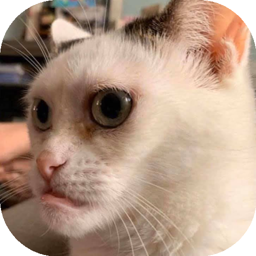
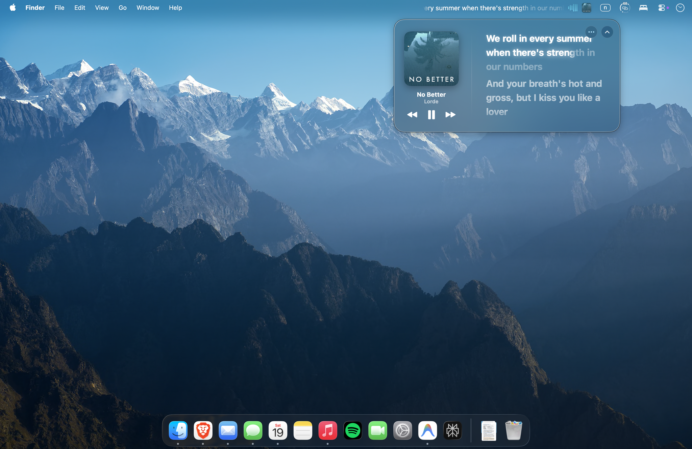
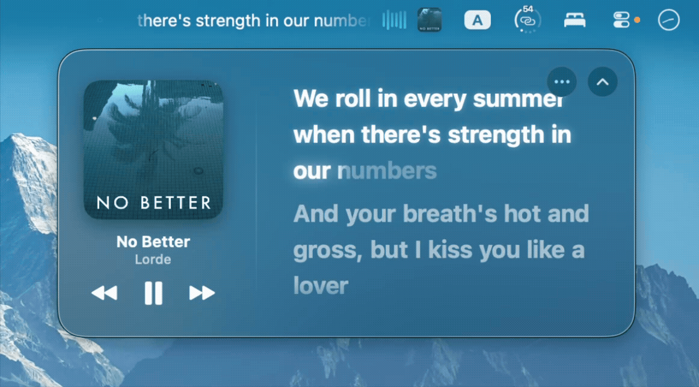

# Lyrics Menu Bar

<p align="center">
  
</p>

<p align="center">
  Rust-powered core engine + zero-SwiftUI native AppKit 60 FPS lyrics, floating glass HUD, audio visualizer, and Force Touch trackpad haptics for macOS 13.0+.
</p>

<p align="center">
  
  
  
  
  
  
</p>

<p align="center">
  
</p>

---

## Table of Contents
- [Features](#features)
- [Ultra-Light Mode & Performance Architecture](#ultra-light-mode--performance-architecture)
- [macOS Compatibility](#macos-compatibility)
- [How It Works](#how-it-works)
- [Requirements](#requirements)
- [Installation](#installation)
- [Building from Source](#building-from-source)
- [Repository Structure](#repository-structure)
- [License](#license)

---

## Features

### Real-Time Menu Bar Lyrics
- Synchronized lyrics displayed directly in the macOS menu bar for **Spotify** and **Apple Music**.
- Supports word/syllable-level karaoke timing when available, with automatic fallback for line-synced and plain lyrics.
- Displays an interlude indicator (`✦ ✦ ✦`) during instrumental sections so you know when the next line starts.
- Smooth marquee scrolling for longer lines and clean play-icon idle state (`play.fill`) when stopped.

<p align="center">
  
</p>

### Dynamic Audio Visualizer *(macOS 14.2+ for live CoreAudio Tap)*
- Real-time frequency spectrum visualizer rendered in the menu bar with true-tone colors sampled from the album cover.
- Configurable bar count (Off, 6, 10, 14, 24, 32, 48, or custom up to 128 bars).
- Asymmetric ballistic filtering with snappy bass rise and smooth decay.
- Flexible display modes: lyrics only, waveform only, or lyrics + waveform + album art.

<p align="center">
  
</p>

### Floating Glass HUD
- Click the menu bar item to toggle the floating glass HUD panel.
- Clean, centered album artwork (tactile pause scale, click to open Spotify or Apple Music) alongside `LazyVStack` lyrics with auto-scroll.
- Playback controls: Previous (rewinds to `0:00` if past 3 seconds), Play/Pause, Next.
- **Click-to-seek**: click any lyric line in the HUD to jump directly to that timestamp.
- **Zero-CPU hidden freeze**: background timers and SwiftUI `TimelineView` loops automatically pause whenever the HUD popover is closed.

<p align="center">
  
</p>

### Force Touch Trackpad Haptics *(macOS 14.2+)*
- Uses the MacBook Force Touch trackpad as a tactile bass companion synced to live audio.
- Analyzes low-frequency transients and fires physical haptic clicks on the beat with a calibrated 5ms acoustic lead time.
- Selectable intensity presets (`Off`, `Light`, `Medium`, `Firm`) and actuator profiles (`Type 1`–`Type 6`).

### In-App Updates & Remote Config
- Automatic update checks against GitHub Releases (`v2.0.0`) with 1-click in-app DMG streaming download (`ureq` in Rust), install, and relaunch.
- Dynamic Git-hosted remote configuration (`remote_config.json`) for zero-downtime lyrics endpoint updates.

---

## Ultra-Light Mode & Performance Architecture

**v2.0.0** eliminates SwiftUI (`SwiftUICore` / `NSHostingView`) completely, pairing a **Rust staticlib core engine** (`liblyrics_core.a`) with a **pure AppKit / `CALayer` shell**. One universal app (**`LyricsMenuBar-2.0.0.dmg`**) sustains **locked 60 FPS VSync smoothness** on everything from Apple Silicon MacBooks down to fanless Intel Macs such as the **MacBook 12" (2017 Core m3)** without ever throttling frame rates down:

### Layer 1: Rust Core Engine + Zero-SwiftUI 60 FPS Pipeline (All Macs)
- **Rust Core Engine (`rust/lyrics-core`)**: Runs zero-allocation 4096-pt `realfft` DSP + beat-synced Force Touch haptics (`IOKit` + `MultitouchSupport`), LRC/eLRC/TTML/Plain lyrics parsing & phonetic word timing, concurrent LRCLib/OVH fetching + 100-item LRU cache, monotonic anti-jitter clock, 12-hue-bucket color extraction, and streaming OTA DMG downloads.
- **Zero-Redraw `CALayer` Menu Bar Canvas & Virtualized HUD**: Both the Menu Bar strip (`MenuBarCanvasView`) and floating HUD stream (`HUDLyricsView`) rasterize each lyric row once into Retina `CGImage`s and animate karaoke wipes (`CAGradientLayer`), spring scrolls, marquee sliding, equalizer bars, and art crossfades directly on CoreAnimation GPU layers — **0 SwiftUI views**, **0 `NSImage.lockFocus()` redraws**.
- **`CVDisplayLink` VSync + 0% CPU Idle/Paused**: Shared `CVDisplayLink` runs at locked 60 FPS (capped from 120 Hz on ProMotion) only during active playback or visible HUD animation, sleeping at **`0 Hz`** whenever playback is paused or idle.
- **Precompiled Background IPC**: Compiles Spotify and Apple Music `NSAppleScript` instances once on a `.utility` background serial queue (`2.0s` coalesced polling + instant `DistributedNotificationCenter` events).

### Layer 2: Reduce Glass & Blur Effects *(Auto-ON on Intel Macs, macOS 13 & Low Power Mode)*
- **Automatic Hardware Detection**: Automatically enabled on `x86_64` Intel Macs, macOS 13 Ventura, or when macOS Low Power Mode is active — and **toggleable anytime** under **Settings → Appearance & Performance → Reduce Glass & Blur Effects (60 FPS Lightweight)**.
- **GPU Bandwidth Savings at Full 60 FPS**:
  - Uses a single-pass native `NSVisualEffectView` HUD backdrop (eliminating multi-pass `CABackdropLayer` saturation compositing and specular strokes on older integrated GPUs such as Intel HD 615) alongside crisp 60 FPS 2D `CASpringAnimation` panel transitions.
  - Skips Gaussian `NSShadow` glow blurs and menu bar sparkle particles while keeping full **60 FPS** karaoke wipes, marquee scrolling, album art transitions, click-to-seek, and OTA updates.

---

## macOS Compatibility

Unsupported system-tap features on macOS 13 Ventura are **automatically greyed out** in Settings with clear macOS 14.2+ requirement labels:

| Feature | macOS 13.0+ (Ventura) | macOS 14.2+ (Sonoma / Sequoia+) |
|---|:---:|:---:|
| 60 FPS GPU-Native Menu Bar Lyrics & Marquee | Supported | Supported |
| 60 FPS Floating HUD Window & Word Karaoke | Supported | Supported |
| Click-to-Seek & Playback Controls | Supported | Supported |
| Reduce Glass & Blur Effects (60 FPS Lightweight) | Auto-ON (Toggleable) | Auto on Intel / Low Power |
| Full Multi-Pass `CABackdropLayer` Glass & 3D Genie | Optional (via Toggle) | Supported |
| Live CoreAudio Process Tap Visualizer | Greyed out (`Requires macOS 14.2+`) | Supported |
| Force Touch Beat-Synced Haptics | Greyed out (`Requires macOS 14.2+`) | Supported |

---

## How It Works

### 1. Audio Capture via CoreAudio Process Tap *(macOS 14.2+)*
- Uses `AudioHardwareCreateProcessTap` (`CATapDescription`) guarded with `@available(macOS 14.2, *)` to capture raw 32-bit float audio directly from Spotify or Apple Music without virtual loopback drivers or kernel extensions.

### 2. Force Touch Actuator Driver (`MultitouchSupport.framework`)
- Communicates with the trackpad actuator via Apple's private `MultitouchSupport.framework` (`MTActuatorCreateFromDeviceID`, `MTActuatorOpen`, `MTActuatorActuate`) matched through `IOKit`, compensating for mechanical rise time ($T_{\text{haptic}} = T_{\text{dac}} - 5\,\text{ms}$).

### 3. Precompiled Event-Driven IPC & Monotonic Clock Interpolation
- Subscribes to `DistributedNotificationCenter` events from Spotify and Apple Music alongside precompiled `NSAppleScript` polling (`2.0s`, `tolerance = 0.4s` on a dedicated `.utility` serial queue) and monotonic clock interpolation:
  $$t_{\text{current}} = t_{\text{polled}} + (t_{\text{now}} - t_{\text{poll}})$$

### 4. Audio Spectrum Analysis (`vDSP` FFT)
- In-place split-complex FFT via Apple Accelerate (`vDSP_fft_zrip`) across logarithmic perceptual bands (60 Hz – 16 kHz) with asymmetric ballistic smoothing. On macOS 13 or when Audio Tap is off, FFT buffers are not allocated.

---

## Requirements

- **macOS 13.0 (Ventura) or later** *(macOS 14.2+ required for CoreAudio Process Tap Visualizer & Beat Haptics)*
- Apple Silicon (`arm64`) or Intel (`x86_64`) Mac
- Spotify or Apple Music desktop app
- MacBook with Force Touch trackpad *(optional, for macOS 14.2+ beat haptics)*

---

## Installation

### Pre-built Universal DMG
1. Download **`LyricsMenuBar-2.0.0.dmg`** from [Releases](https://github.com/tum212/Lyrics-Menu-Bar/releases).
2. Drag **Lyrics Menu Bar** into your `/Applications` folder.
3. Grant **Automation** permissions when prompted on first launch *(and **System Audio Recording** on macOS 14.2+ if using the live audio visualizer)*.

> [!TIP]
> **If macOS blocks the app on first launch (Gatekeeper):**  
> Right-click the app in `/Applications` and select **Open**, or run:
> ```bash
> xattr -cr "/Applications/Lyrics Menu Bar.app"
> ```

---

## Building from Source

```bash
# 1. Install Rust toolchain with universal Apple Silicon + Intel targets
rustup target add aarch64-apple-darwin x86_64-apple-darwin

# 2. Clone the repository
git clone https://github.com/tum212/Lyrics-Menu-Bar.git
cd Lyrics-Menu-Bar

# 3. Build universal Rust core + Universal macOS DMG (arm64 + x86_64, macOS 13.0+)
bash build_dmg.sh
```

---

## Repository Structure

```text
SpoticatMenuBar/
├── Package.swift                       # Swift 6 Package manifest (CLyricsCore + AppKit macOS 13.0+)
├── build_dmg.sh                        # Universal Rust + Swift DMG packaging script (arm64 + x86_64)
├── LyricsMenuBar.entitlements          # Hardened runtime & CoreAudio entitlements
├── remote_config.json                  # Remote OTA version & lyrics endpoints config
├── icon.icns                           # Application icon
├── docs/images/                        # Screenshots and demo GIFs
├── rust/lyrics-core/                   # Rust staticlib Core Engine (liblyrics_core.a)
│   ├── Cargo.toml
│   └── src/
│       ├── lib.rs & ffi.rs             # C ABI exports & panic-safe FFI boundary
│       ├── dsp.rs                      # Zero-alloc 4096-pt realfft DSP & equalizer physics
│       ├── haptics.rs                  # MultitouchSupport / IOKit beat-synced Force Touch haptics
│       ├── lyrics.rs                   # LRC/eLRC/TTML/Plain parsers, syllable timing & LRU fetcher
│       ├── playback.rs                 # Monotonic clock & Menu Bar animation state machine
│       ├── color.rs                    # 12-hue album palette extractor & artwork networking
│       └── updater.rs                  # Remote config & streaming OTA DMG downloader
├── Sources/
│   ├── CLyricsCore/include/
│   │   ├── lyrics_core.h               # C header generated for Swift/Clang interop
│   │   └── module.modulemap
│   └── LyricsMenuBar/                  # Zero-SwiftUI AppKit / CALayer Shell
│       ├── Info.plist                  # Universal bundle metadata (v2.0.0, LSMinimumSystemVersion 13.0)
│       ├── AppSettings.swift           # Capability detection, Lightweight defaults & keys
│       ├── RustBridge.swift            # Swift facade over liblyrics_core.a & NSCache images
│       ├── LyricsMenuBarApp.swift      # App entry point, 60 FPS CVDisplayLink & Genie panel
│       ├── MenuBarCanvasView.swift     # GPU-native CALayer menu bar renderer
│       ├── HUDGlassView.swift          # Adaptive AppKit / CABackdropLayer glass backdrop
│       ├── HUDContentView.swift        # Pure AppKit 480x240 HUD & Software Update modal
│       ├── HUDLyricsView.swift         # Virtualized 60 FPS CALayer HUD karaoke stream
│       ├── SettingsMenuController.swift# Native AppKit NSMenu settings
│       ├── AudioTapBridge.swift        # CoreAudio Process Tap -> Rust DSP bridge (macOS 14.2+)
│       ├── MusicIPCBridge.swift        # Spotify & Apple Music Notification/AppleScript bridge
│       └── LaunchAtLoginManager.swift  # SMAppService login item manager
└── README.md                           # Documentation & GitHub landing page
```

---

## License

This project is licensed under the MIT License. See [LICENSE](LICENSE) for details.
