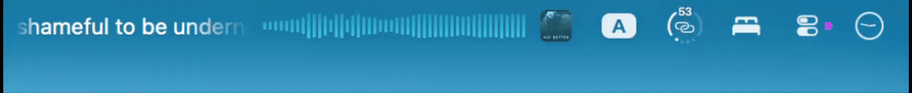

# Lyrics Menu Bar

<p align="center">
  
</p>

<p align="center">
  Ultra-lightweight synchronized lyrics, floating glass HUD, audio visualizer, and Force Touch trackpad haptics for macOS 13.0+.
</p>

<p align="center">
  
  
  
  
  
  
</p>

<p align="center">
  
</p>

---

## Table of Contents
- [Features](#features)
- [Ultra-Light Mode & Performance Architecture](#ultra-light-mode--performance-architecture)
- [macOS Compatibility](#macos-compatibility)
- [How It Works](#how-it-works)
- [Requirements](#requirements)
- [Installation](#installation)
- [Building from Source](#building-from-source)
- [Repository Structure](#repository-structure)
- [License](#license)

---

## Features

### Real-Time Menu Bar Lyrics
- Synchronized lyrics displayed directly in the macOS menu bar for **Spotify** and **Apple Music**.
- Supports word/syllable-level karaoke timing when available, with automatic fallback for line-synced and plain lyrics.
- Displays an interlude indicator (`✦ ✦ ✦`) during instrumental sections so you know when the next line starts.
- Smooth marquee scrolling for longer lines and clean play-icon idle state (`play.fill`) when stopped.

<p align="center">
  
</p>

### Dynamic Audio Visualizer *(macOS 14.2+ for live CoreAudio Tap)*
- Real-time frequency spectrum visualizer rendered in the menu bar with true-tone colors sampled from the album cover.
- Configurable bar count (Off, 6, 10, 14, 24, 32, 48, or custom up to 128 bars).
- Asymmetric ballistic filtering with snappy bass rise and smooth decay.
- Flexible display modes: lyrics only, waveform only, or lyrics + waveform + album art.

<p align="center">
  
</p>

### Floating Glass HUD
- Click the menu bar item to toggle the floating glass HUD panel.
- Clean, centered album artwork (tactile pause scale, click to open Spotify or Apple Music) alongside `LazyVStack` lyrics with auto-scroll.
- Playback controls: Previous (rewinds to `0:00` if past 3 seconds), Play/Pause, Next.
- **Click-to-seek**: click any lyric line in the HUD to jump directly to that timestamp.
- **Zero-CPU hidden freeze**: background timers and SwiftUI `TimelineView` loops automatically pause whenever the HUD popover is closed.

<p align="center">
  
</p>

### Force Touch Trackpad Haptics *(macOS 14.2+)*
- Uses the MacBook Force Touch trackpad as a tactile bass companion synced to live audio.
- Analyzes low-frequency transients and fires physical haptic clicks on the beat with a calibrated 5ms acoustic lead time.
- Selectable intensity presets (`Off`, `Light`, `Medium`, `Firm`) and actuator profiles (`Type 1`–`Type 6`).

### In-App Updates & Remote Config
- Automatic update checks against GitHub Releases (`v1.3.1`) with 1-click in-app DMG download, install, and relaunch.
- Dynamic Git-hosted remote configuration (`remote_config.json`) for zero-downtime lyrics endpoint updates.

---

## Ultra-Light Mode & Performance Architecture

One universal app (**`LyricsMenuBar-1.3.1.dmg`**) runs smoothly on everything from Apple Silicon MacBooks to fanless Intel Macs such as the **MacBook 12" (2017 Core m3)** using a two-layer architecture:

### Layer 1: Universal Always-On Optimizations (All Macs)
- **0% Idle & Paused CPU**: Menu bar timers shut down (`0 Hz`) whenever playback is paused or idle, waking instantly via `DistributedNotificationCenter` and Combine publishers on track or state changes.
- **Hidden HUD Freeze**: `LyricsStreamView` and `TimelineView` animations pause immediately when the HUD panel closes and resynchronize on open.
- **Virtualized `LazyVStack` Lyrics**: Only visible rows are instantiated instead of laying out an entire song at once.
- **Pre-cached Metrics & Compact Artwork**: Caches `UserDefaults`, `NSFont` attributes, measured string widths, and downscales cached album artwork to 240–300px (`@2x` Retina sharp at 120pt) to minimize RAM.

### Layer 2: Adaptive `Ultra-Light Mode` *(Auto-ON on Intel Macs, macOS 13 & Low Power Mode)*
- **Automatic Hardware Detection**: Automatically enabled on `x86_64` Intel Macs, macOS 13 Ventura, or when macOS Low Power Mode is active — and **toggleable anytime** under **Settings → Appearance & Performance → Ultra-Light Mode**.
- **Low-Overhead Rendering**:
  - Caps active menu bar updates to **12 FPS** with macOS timer coalescing (`tolerance = 25ms`).
  - Uses direct `NSBezierPath.clip` highlighting instead of offscreen mask buffers, and skips CPU Gaussian `NSShadow` blurs and 18-star sparkle animations.
  - Uses a single-pass native `NSVisualEffectView` HUD backdrop (eliminating dual-backdrop `CABackdropLayer` saturation passes and per-line GPU blur filters on older integrated GPUs) with snappy 2D open/close transitions.
  - Preserves all core features: full Menu Bar lyrics, word-by-word karaoke highlighting, click-to-seek, playback controls, and OTA updates.

---

## macOS Compatibility

Unsupported system-tap features on macOS 13 Ventura are **automatically greyed out** in Settings with clear macOS 14.2+ requirement labels:

| Feature | macOS 13.0+ (Ventura) | macOS 14.2+ (Sonoma / Sequoia+) |
|---|:---:|:---:|
| Menu Bar Synchronized Lyrics & Marquee | Supported | Supported |
| Floating HUD Window & Word Karaoke | Supported | Supported |
| Click-to-Seek & Playback Controls | Supported | Supported |
| Ultra-Light Mode (Settings Toggle) | Auto-ON | Auto on Intel / Low Power |
| Full Multi-Layer Glass & 3D Genie | Optional (via Toggle) | Supported |
| Live CoreAudio Process Tap Visualizer | Greyed out (`Requires macOS 14.2+`) | Supported |
| Force Touch Beat-Synced Haptics | Greyed out (`Requires macOS 14.2+`) | Supported |

---

## How It Works

### 1. Audio Capture via CoreAudio Process Tap *(macOS 14.2+)*
- Uses `AudioHardwareCreateProcessTap` (`CATapDescription`) guarded with `@available(macOS 14.2, *)` to capture raw 32-bit float audio directly from Spotify or Apple Music without virtual loopback drivers or kernel extensions.

### 2. Force Touch Actuator Driver (`MultitouchSupport.framework`)
- Communicates with the trackpad actuator via Apple's private `MultitouchSupport.framework` (`MTActuatorCreateFromDeviceID`, `MTActuatorOpen`, `MTActuatorActuate`) matched through `IOKit`, compensating for mechanical rise time ($T_{\text{haptic}} = T_{\text{dac}} - 5\,\text{ms}$).

### 3. Event-Driven IPC & Monotonic Clock Interpolation
- Subscribes to `DistributedNotificationCenter` events from Spotify and Apple Music alongside low-priority coalesced AppleScript polling (`1.5s` Standard / `3.0s` Ultra-Light) and monotonic clock interpolation:
  $$t_{\text{current}} = t_{\text{polled}} + (t_{\text{now}} - t_{\text{poll}})$$

### 4. Audio Spectrum Analysis (`vDSP` FFT)
- In-place split-complex FFT via Apple Accelerate (`vDSP_fft_zrip`) across logarithmic perceptual bands (60 Hz – 16 kHz) with asymmetric ballistic smoothing. On macOS 13 or when Audio Tap is off, FFT buffers are not allocated.

---

## Requirements

- **macOS 13.0 (Ventura) or later** *(macOS 14.2+ required for CoreAudio Process Tap Visualizer & Beat Haptics)*
- Apple Silicon (`arm64`) or Intel (`x86_64`) Mac
- Spotify or Apple Music desktop app
- MacBook with Force Touch trackpad *(optional, for macOS 14.2+ beat haptics)*

---

## Installation

### Pre-built Universal DMG
1. Download **`LyricsMenuBar-1.3.1.dmg`** from [Releases](https://github.com/tum212/Lyrics-Menu-Bar/releases).
2. Drag **Lyrics Menu Bar** into your `/Applications` folder.
3. Grant **Automation** permissions when prompted on first launch *(and **System Audio Recording** on macOS 14.2+ if using the live audio visualizer)*.

> [!TIP]
> **If macOS blocks the app on first launch (Gatekeeper):**  
> Right-click the app in `/Applications` and select **Open**, or run:
> ```bash
> xattr -cr "/Applications/Lyrics Menu Bar.app"
> ```

---

## Building from Source

```bash
# Clone the repository
git clone https://github.com/tum212/Lyrics-Menu-Bar.git
cd Lyrics-Menu-Bar

# Build release binary via Swift Package Manager (macOS 13.0+)
swift build -c release

# Or package the Universal (arm64 + x86_64) DMG
bash build_dmg.sh
```

---

## Repository Structure

```text
SpoticatMenuBar/
├── Package.swift                       # Swift 6 Package manifest (Universal macOS 13.0+)
├── build_dmg.sh                        # Universal DMG packaging script (arm64 + x86_64)
├── LyricsMenuBar.entitlements          # Hardened runtime & CoreAudio entitlements
├── remote_config.json                  # Remote OTA version & lyrics endpoints config
├── icon.icns                           # Application icon
├── docs/images/                        # Screenshots and demo GIFs
├── Sources/
│   └── LyricsMenuBar/
│       ├── Info.plist                  # Universal bundle metadata (LSMinimumSystemVersion 13.0)
│       ├── AppSettings.swift           # Capability detection, Ultra-Light Mode & defaults
│       ├── LyricsMenuBarApp.swift      # App entry point, adaptive menu bar engine & HUD panel
│       ├── ContentView.swift           # Floating HUD, LazyVStack lyrics stream & settings menu
│       ├── HUDGlassView.swift          # Adaptive AppKit / CABackdropLayer glass backdrop
│       ├── MusicService.swift          # Event-driven Spotify & Apple Music IPC bridge
│       ├── LyricsService.swift         # Lyrics fetching, LRU cache & syllable timing calculator
│       ├── ArtworkLoader.swift         # URL sanitizer, compact downscaler & NSCache artwork store
│       ├── AudioAnalyzer.swift         # CoreAudio Process Tap & vDSP FFT analyzer (macOS 14.2+)
│       ├── HapticManager.swift         # Force Touch trackpad actuator driver (macOS 14.2+)
│       ├── ColorExtractor.swift        # Album art palette extraction
│       ├── RemoteConfigManager.swift   # Git-hosted dynamic config fetcher
│       ├── UpdateManager.swift         # In-app OTA version checker & DMG installer
│       ├── LaunchAtLoginManager.swift  # SMAppService login item manager
│       └── SpotifyService.swift        # Backwards compatibility alias
└── README.md                           # Documentation & GitHub landing page
```

---

## License

This project is licensed under the MIT License. See [LICENSE](LICENSE) for details.
